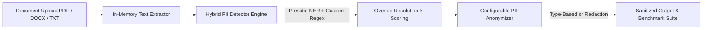

# 🛡️ PrivacyShield AI – Adaptive Privacy–Utility Optimization for Local LLM-Based Document Processing

---

## 📌 Project Overview

**PrivacyShield AI** is an enterprise-grade, privacy-preserving document processing framework designed to sanitize sensitive files prior to downstream analysis. Built for local and offline deployment, the platform ensures that no document bytes or raw text ever leave local system memory.

The system combines safe multi-format document extraction, a hybrid PII (Personally Identifiable Information) detection engine combining statistical NLP with custom domain regex patterns, and index-consistent anonymization strategies.

---

## 🚨 Problem Statement

Deploying Large Language Models (LLMs) for document analysis poses severe privacy risks when handling documents containing sensitive Personal Data:
- **Cloud Data Leakage**: Sending unredacted documents to cloud-hosted LLM APIs exposes confidential customer, financial, and personal data to third-party endpoints.
- **Regulatory Non-Compliance**: Inadvertent transmission of PII violates global privacy laws including GDPR, HIPAA, and the Digital Personal Data Protection (DPDP) Act.
- **Utility vs. Privacy Dilemma**: Naive redaction often destroys essential context, rendering anonymized documents useless for downstream reasoning and summarization tasks.

---

## 🎯 Objectives

1. **Zero-Cloud Memory Processing**: Extract text from documents entirely in memory without writing temporary files to local storage or external cloud services.
2. **High-Recall Hybrid Detection**: Detect standard PII (Names, Emails, Phone Numbers, Locations) and regional entities (e.g., Indian phone numbers) with minimal false negatives.
3. **Utility-Preserving Anonymization**: Replace sensitive entities with indexed, type-aware placeholders (`[PERSON_1]`, `[EMAIL_1]`) while preserving repeated entity relationships and surrounding grammatical context.
4. **Empirical Evaluation Benchmark**: Provide automated benchmark testing measuring extraction success, detection accuracy (Precision, Recall, F1-Score), residual PII exposure, and context retention.

---

## ✨ Main Features

- **Multi-Format Extraction**: In-memory parsing for `.pdf`, `.docx`, and `.txt` files.
- **Hybrid PII Detection Engine**: Microsoft Presidio Analyzer integrated with custom regex recognizers and an overlap resolution algorithm for contiguous detection bounds.
- **Dual Anonymization Strategies**:
  - **Type-Based Replacement**: Maps unique entities to index labels (e.g., `[PERSON_1]`, `[EMAIL_1]`), preserving identical labels across repeated mentions.
  - **Redaction**: Replaces all sensitive detections with standard `[REDACTED]` markers.
- **Interactive Cybersecurity UI**: Built with Streamlit featuring side-by-side text diffing, confidence score filtering, and one-click file download.
- **Comprehensive Evaluation Pipeline**: Standardized benchmark suite (`evaluation.py`) assessing extraction, detection metrics, anonymization safety, and context retention.

---

## 🔄 System Workflow



1. **Upload & Extract**: The file is loaded into memory as a byte stream and converted to plain text.
2. **Hybrid Scan**: Presidio Analyzer identifies candidate entities via spaCy NER while custom regex engines scan for specific patterns (e.g., Indian phone numbers, high-precision email patterns).
3. **Overlap Resolution**: Overlapping or duplicate bounding boxes are merged, prioritizing higher confidence scores and longer spans.
4. **Anonymization**: Text is transformed using reverse-order string replacement to maintain offset integrity.
5. **Output & Audit**: The sanitized text is presented side-by-side with original text and made available for download or downstream consumption.

---

## 📁 Project Structure

```
PrivacyShield-AI/
├── app.py                      # Interactive Streamlit Web Dashboard
├── evaluation.py               # Empirical Evaluation & Benchmark Runner
├── requirements.txt            # Python Dependencies
├── README.md                   # Project Documentation
├── .gitignore                  # Git Exclusion Rules
├── modules/
│   ├── __init__.py
│   ├── document_extractor.py   # Safe text extraction from TXT, PDF, DOCX
│   ├── pii_detector.py         # Hybrid Presidio + Regex PII detector engine
│   └── anonymizer.py           # Type-based & Redaction anonymization engine
├── tests/
│   ├── __init__.py
│   ├── test_document_extractor.py # Unit tests for document extraction
│   ├── test_pii_detector.py       # Unit tests for PII detection
│   └── test_anonymizer.py         # Unit tests for anonymization
└── sample_documents/
    └── sample_pii.txt          # Synthetic sample document with test PII
```

---

## 🛠️ Technologies & Libraries

- **Language**: Python 3.9+ (Tested on Python 3.11)
- **Web UI**: Streamlit 1.28+
- **Document Extractors**: PyMuPDF (`fitz`), `python-docx`
- **PII Detection**: Microsoft Presidio Analyzer (`presidio-analyzer`), spaCy (`en_core_web_sm`)
- **Data Processing**: Pandas
- **Testing**: pytest

---

## 📄 Supported Document Formats

| Format | Library | Extraction Method |
| :--- | :--- | :--- |
| **PDF (`.pdf`)** | PyMuPDF (`fitz`) | Multi-page text stream parsing |
| **DOCX (`.docx`)** | `python-docx` | Paragraph & table text extraction |
| **TXT (`.txt`)** | Built-in | UTF-8 / Latin-1 fallback decoding |

---

## 🔍 PII Detection Methods

- **Statistical NER**: Presidio Analyzer backed by spaCy's `en_core_web_sm` model for standard entities:
  - `PERSON`: Full names and individual identities.
  - `EMAIL_ADDRESS`: Standard email patterns.
  - `PHONE_NUMBER`: Global phone number patterns.
  - `LOCATION`: Cities, countries, states, and geographic entities (`GPE` / `LOC`).
- **Custom Pattern Recognizers**: Regex recognizers registered into Presidio's engine:
  - **Indian Phone Numbers**: Handles `+91 9876543210`, `+91-98765-43210`, `09876543210`, and 10-digit mobile formats starting with 6-9.
  - **High-Precision Email Regex**: Fallback patterns to prevent missed sub-domain emails.
- **Overlap Resolution**: Deduplicates overlapping spans by picking highest confidence and maximum span length.

---

## 🔒 Anonymization Methods

1. **Type-Based Replacement (Recommended)**
   - Replaces entities with indexed labels: `[PERSON_1]`, `[PERSON_2]`, `[EMAIL_1]`, `[PHONE_1]`, `[LOCATION_1]`.
   - **Entity Mapping Consistency**: If `Aarav Sharma` appears multiple times in a document, every instance is mapped to `[PERSON_1]`.
2. **Redaction**
   - Replaces all detected entity spans with a standard `[REDACTED]` token.

---

## 📊 Evaluation Metrics

The system includes a dedicated benchmark suite (`evaluation.py`) assessing 5 key metrics:

| Metric | Description | Target / Typical Result |
| :--- | :--- | :--- |
| **Extraction Success Rate** | % of valid document formats successfully converted to text | **100.0%** |
| **Detection Precision** | $\frac{TP}{TP + FP}$ against ground-truth dataset | **1.00** |
| **Detection Recall** | $\frac{TP}{TP + FN}$ against ground-truth dataset | **0.94+** |
| **Detection F1-Score** | Harmonic mean of Precision and Recall | **0.96+** |
| **Residual PII Rate** | % of PII remaining after re-scanning anonymized text | **0.0%** |
| **Context Retention Rate** | % of non-PII tokens preserved in anonymized output | **100.0%** |

---

## ⚙️ Installation & Setup

### 1. Prerequisites
- Python 3.9 or higher (Python 3.11 recommended)
- Git

### 2. Clone Repository & Setup Environment
```bash
git clone <repository_url>
cd PrivacyShield-AI

# Create virtual environment
python -m venv .venv

# Activate virtual environment
# On Windows (PowerShell):
.venv\Scripts\Activate.ps1
# On Linux/macOS:
source .venv/bin/activate
```

### 3. Install Dependencies
```bash
pip install -r requirements.txt
```

### 4. Download spaCy English Language Model
```bash
python -m spacy download en_core_web_sm
```

---

## 🚀 How to Run the Application

Launch the interactive cybersecurity dashboard:

```bash
streamlit run app.py
```

Open your browser at `http://localhost:8501`.

---

## 🧪 How to Run Evaluation & Tests

### 1. Run Benchmark Evaluation
Run the automated system evaluation report across all 5 evaluation modules:
```bash
python evaluation.py
```

### 2. Run Unit Test Suite
Run the 15 pytest unit tests:
```bash
# Standard pytest execution:
python -m pytest tests/ -v

# Windows PowerShell fallback if third-party pytest plugins interfere:
$env:PYTEST_DISABLE_PLUGIN_AUTOLOAD="1"; python -m pytest tests/ -v
```

---

## 💡 Example Usage

```python
from modules.document_extractor import extract_text
from modules.pii_detector import HybridPIIDetector
from modules.anonymizer import PIIAnonymizer

# 1. Read document bytes
with open("sample_documents/sample_pii.txt", "rb") as f:
    file_bytes = f.read()

# 2. Extract Text
text = extract_text(file_bytes, "sample_pii.txt")

# 3. Detect PII
detector = HybridPIIDetector()
detections = detector.analyze_text(text, score_threshold=0.4)

# 4. Anonymize Text
anonymizer = PIIAnonymizer()
anonymized_text, metadata = anonymizer.anonymize(text, detections, strategy="type_based")

print("Sanitized Output:\n", anonymized_text)
```

---

## 🚀 Future Enhancements & Roadmap

> **Note on Current Scope**: The baseline version implements local document parsing, hybrid PII detection, anonymization strategies, and empirical benchmark metrics. The features below represent planned future extensions:

- **Local LLM Integration**: Direct connection to local inference runtimes (e.g., Ollama, Llama.cpp, vLLM) for offline summarization and Q&A on sanitized documents.
- **Adaptive Privacy–Utility Optimization**: Dynamic optimization algorithms that tune detection thresholds and redaction intensity based on downstream LLM task utility requirements versus privacy risk tolerance.
- **Custom Entity Rule Builder**: User-facing UI component for defining custom Regex and Keyword recognizers on the fly.
- **Audit Logging**: Cryptographically signed local log generation for privacy compliance auditing.

---

## 📄 License

Academic CSE AI/ML Final-Year Project.
